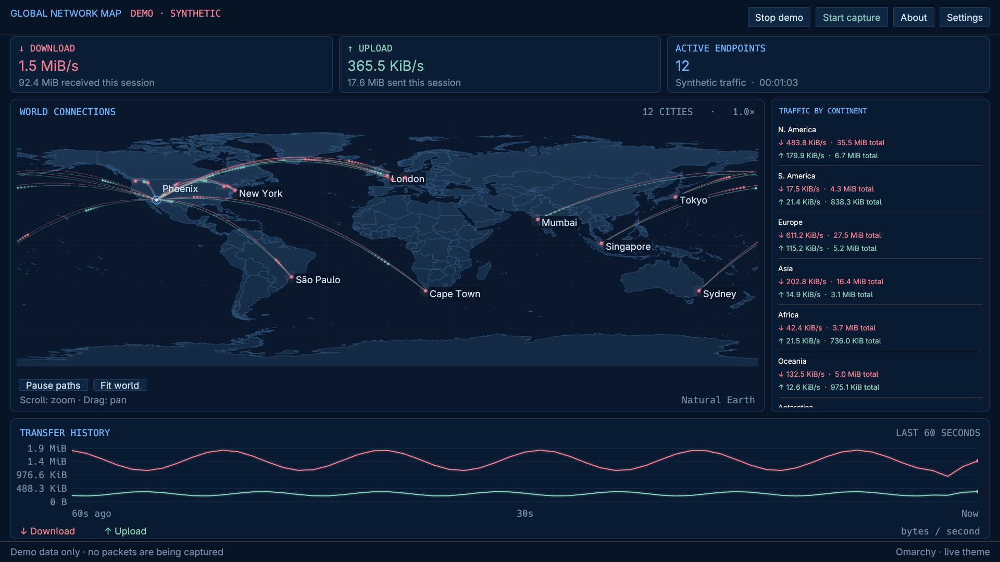

# Global Network Map

A standalone Rust app for this computer's network traffic, with native graphical and terminal interfaces. Both follow the active Omarchy theme and share capture, local geolocation, and traffic accounting. Kitty, Alacritty, and Ghostty are the target terminals.

## Install on Omarchy / Arch Linux

Download the **x86_64 Arch package** and `SHA256SUMS` from [Releases](https://github.com/vandrare/global-network-map/releases/latest). Version 0.1.0 ships for x86_64 only and targets current Arch/Omarchy libraries.

```sh
# Run in the directory containing both downloaded files.
sha256sum --ignore-missing -c SHA256SUMS
sudo pacman -U ./global-network-map-0.1.0-1-x86_64.pkg.tar.zst
```

Launch **Global Network Map** from the Omarchy application menu or run `global-network-map-gui`. A desktop polkit authentication agent must be running for live capture; Omarchy provides one. Start with `global-network-map-gui --demo` to preview without authentication. In Settings, choose your physical origin and interface, save, and start capture. Use **Update database** in Settings for city lookups; traffic accounting works without a database.

Pacman resolves runtime dependencies. This is an upstream package, not yet listed in the official Omarchy repository or AUR. Install downloaded packages with `pacman -U`; `omarchy pkg add global-network-map` becomes applicable only after repository acceptance. For updates, download and install the next release package the same way. Remove it with `sudo pacman -R global-network-map`; personal configuration and downloaded databases remain in your home directory.

### User installation without a system package

Download `global-network-map-0.1.0-linux-x86_64.tar.gz` and `SHA256SUMS` from the same release, verify the checksum, then:

```sh
omarchy pkg add libpcap libxkbcommon libglvnd wayland libx11 libxcursor libxi libxrandr polkit sudo iproute2 curl python hicolor-icon-theme desktop-file-utils
tar -xzf global-network-map-0.1.0-linux-x86_64.tar.gz
cd global-network-map-0.1.0-linux-x86_64
./install.sh
```

The archive contains all three prebuilt executables, an icon, a launcher installer, documentation, licences and a demo screenshot. Its installer writes to `~/.local/bin` and the XDG data directory, runs as your normal user, and does not require Rust. Ensure `~/.local/bin` is on PATH. Re-run the installer from a newer archive to update. To remove this installation:

```sh
rm ~/.local/bin/global-network-map ~/.local/bin/global-network-map-gui ~/.local/bin/global-network-map-capture
rm "${XDG_DATA_HOME:-$HOME/.local/share}/applications/global-network-map.desktop"
rm "${XDG_DATA_HOME:-$HOME/.local/share}/icons/hicolor/scalable/apps/global-network-map.svg"
```

Choose one installation method. A user installation in `~/.local/bin` may take precedence over a system package; remove those three user executables and its desktop entry when switching to pacman.

### Build from source

```sh
omarchy pkg add rust base-devel libpcap libxkbcommon libglvnd wayland libx11 libxcursor libxi libxrandr polkit sudo iproute2 curl python hicolor-icon-theme desktop-file-utils
git clone https://github.com/vandrare/global-network-map.git
cd global-network-map
git checkout v0.1.0
./install-gui.sh
```

The Arch recipe and Omarchy metadata live in `packaging/omarchy/`. Its layout follows the [official Omarchy package repository](https://github.com/omacom/omarchy-pkgs): a PKGBUILD plus `.omarchy/package.json`. It installs binaries into `/usr/bin`, the desktop entry and icon into `/usr/share`, and licences and attribution with the package. Omarchy maintainers control official signing and repository publication; this release does not claim that acceptance.



## Graphical version

```sh
./install-gui.sh
global-network-map-gui --demo
global-network-map-gui
```

Launch **Global Network Map** from the desktop application menu. In **Settings**, select your physical city with offline search, or enter city/country and coordinates manually. Choose the VPN tunnel interface when needed, save, then click **Start capture**. The desktop authentication prompt authorizes only the capture helper. The window remains unprivileged. **Stop capture** retains session totals; starting another session resets them.

The graphical app adds a filled Natural Earth 1:50m map with country borders, animated directional paths, and a continuous upload/download line graph covering the last 60 seconds. Hover a city for its country and traffic details; hover the graph for an observed sample. Scroll the map to zoom, drag to pan, and double-click or choose **Fit world** to reset. Up to 256 cities have paths and 18 have labels. The right sidebar beside the map includes Local and Unknown rows so all traffic is accounted for. It scrolls when needed. The map stretches to fill its panel, and the transfer history spans the width below it. GUI labels use 18px text, with 14px text in the continent sidebar, and live Omarchy theme colors.

The default requested window is 1440 × 960, with a 960 × 720 minimum dashboard size. A tiling compositor can allocate less space: resize the window, press **F11**, or use the resize screen's fullscreen button. F11 toggles fullscreen; `--fullscreen` opens it that way. Escape dismisses Settings/About. Closing the window stops its helper.

```sh
global-network-map-gui --interface tun0
global-network-map-gui --start                  # request capture on launch
global-network-map-gui --demo --fullscreen
global-network-map-gui --demo --screenshot graphical-preview.png --quit-after 15
```

Screenshots capture only the app's own framebuffer, use a fullscreen demo, and exit. Demo data is always labeled synthetic, including after stopping it. The default GUI palette outside Omarchy is a built-in dark palette; on Omarchy the colors reload automatically.

The GUI installer also updates the terminal app and shared helper. Additional runtime dependencies: an OpenGL-capable display, Wayland or X11, libxkbcommon, `pkexec`, and a running desktop polkit authentication agent. The installer uses Python 3 for the desktop entry. GUI builds are opt-in with `--features gui`; normal terminal builds remain small. It installs no service and changes no window-manager configuration.

See [graphical-preview.png](graphical-preview.png) for a rendered demo.

## Start

```sh
cargo build --release --locked
./target/release/global-network-map --demo
./target/release/global-network-map --update-db
./target/release/global-network-map
```

The first live launch opens an **offline city picker**. Type a city and country (for example `Paris, FR`), use the arrow keys, and press Enter. The bundled GeoNames list includes cities with a population above 15,000 and some administrative seats. For a smaller place, supply coordinates:

```sh
global-network-map --setup --origin 'My City,My Country,33.45,-112.07'
```

Live capture asks for sudo in the terminal before drawing the interface. Only the capture helper opens the network interface with root privileges; it then permanently drops to the invoking user. The UI never runs as root. No service, persistent capability grant, firewall change, or packet log is installed.

Minimum dashboard size: **120 columns × 35 rows**. Below that, a resize screen appears while capture continues. The city picker needs 70 × 23. The app restores terminal input, mouse reporting, and the cursor on exit, Ctrl+C, SIGTERM, and Rust panics.

## Install for your user

```sh
./install.sh
global-network-map --demo
```

The installer builds both binaries and installs them together in `~/.local/bin`. Runtime dependencies: `libpcap`, `sudo`, `iproute2`, `curl`, and `coreutils` (`sha256sum`). Build dependencies: Rust/Cargo, a C linker, and libpcap development files. On Omarchy, install missing packages using `omarchy pkg add`.

## Controls

| Input | Action |
| --- | --- |
| Mouse over a city marker | City, country, active endpoint count, rates, and bytes for displayed endpoints |
| `o` | Change the configured origin using offline search |
| Space | Pause/resume tracer animation; accounting continues |
| `?` | Help, accounting details, and attribution |
| `q` / Ctrl+C | Quit |
| Esc | Close help/city picker, otherwise quit |

Cities with several active endpoint IPs share one marker. Endpoints remain active on the map for 30 seconds after traffic. Paths fade after eight seconds. Up to 128 active cities have paths and up to 12 have labels to limit clutter. Hover works at the city marker even if its label is hidden. All observed traffic contributes to the table and session totals, including traffic with no mapped city.

Tracers illustrate transfer direction between locations; they are not measured physical routes or traceroute results.

## VPNs and interfaces

```sh
global-network-map --list-interfaces
global-network-map --interface tun0
```

Automatic selection asks the kernel which interface routes an ordinary Internet destination (`ip route get 1.1.1.1`; this does not send a packet). If routing information is unavailable, it prefers an active tunnel, then another active interface. The interface is always shown in the header. Use `--interface` for split tunnels, multiple VPNs, or unusual routes.

The **origin setting is only a map anchor**. It does not change routing or geolocate your physical computer automatically. A configured home city avoids drawing the computer at the VPN exit location.

The selected interface determines traffic visibility:

- A VPN tunnel exposes the inner remote destinations when supported by the VPN.
- A physical interface with a VPN generally exposes the encrypted connection to the VPN server.
- Exactly one interface is captured, preventing double-counting encrypted and inner traffic. Split-tunnel traffic on other interfaces is outside that session.
- Restart the app after connecting/disconnecting a VPN or changing routes. IP address changes on the selected interface are refreshed during capture.
- Capture is non-promiscuous. Only IP packets whose source or destination is an address on the selected interface are included. Forwarded/router traffic, loopback, and inbound broadcasts not addressed to a local IP are excluded. VPNs implemented only as application proxies may have no capturable inner tunnel.

## Location database and optional public-IP suggestion

```sh
global-network-map --update-db
global-network-map --database /path/to/city.mmdb
global-network-map --suggest-origin
```

`--update-db` explicitly downloads the DB-IP Lite IPv4 and IPv6 city MMDBs distributed by [sapics/ip-location-db](https://github.com/sapics/ip-location-db). It checks SHA-256 hashes attached to the GitHub release assets (falling back to the publisher's checksum files for assets without a digest) and validates each MMDB before replacing existing files. Updates are manual; normal operation makes **no geolocation requests**. Downloads contact GitHub, its API, and its release-asset hosts.

`--suggest-origin` explicitly contacts `https://api.ipify.org` to obtain the public exit IP, then looks it up locally. With a VPN, this suggests the VPN exit city. It prints a suggestion and never changes your configured origin. Run `--setup` to select your physical city.

IP geolocation is approximate and can reflect a hosting/CDN/ISP location rather than a device's physical location. Cityless records are counted by country/continent but are not drawn at invented city coordinates. No database is required for accounting: public traffic without a country match appears under Unknown. Private/special addresses appear under Local. An existing standard GeoIP2 city MMDB or a sapics flat-schema MMDB can be used with `--database`.

## Accounting

- Inbound/download uses the theme's **red** (`red` or `color1`). Outbound/upload uses **green** (`green` or `color2`). These slots need not look literally red/green in every theme; arrows and labels identify direction too.
- Rates update approximately once per second, in binary units (KiB/s, MiB/s).
- Session totals start when capture starts and reset on launch. They include IP headers and retransmissions, not Ethernet framing or non-IP packets. They are traffic counts, not application goodput or ISP billing counters; offload behavior can affect observed packet sizes.
- Continent classification follows the remote endpoint's country. Local and Unknown rows preserve total reconciliation. Country-known/city-unknown traffic still counts under its continent.
- No per-app activity, payload inspection, packet persistence, or historical traffic database is included.
- The helper exports only aggregated remote IP addresses and directional byte counts. It snapshots at most the first 128 bytes of each frame for header decoding and does not persist them.
- The UI retains up to 8,192 endpoints. Oldest endpoints can be evicted; overall/continent session totals are retained. Tooltip totals cover the currently displayed endpoints, not every endpoint ever seen in that city.
- Capture drop counts are visible if libpcap reports lost packets. Those losses cannot be reconstructed, so totals then undercount.

## Configuration and themes

Config: `${XDG_CONFIG_HOME:-~/.config}/global-network-map/config.toml`

```toml
# Optional: override automatic selection and local databases.
# interface = "tun0"
# database = "/path/to/city.mmdb"

[origin]
city = "Phoenix"
country = "United States"
latitude = 33.4484
longitude = -112.074
```

Data: `${XDG_DATA_HOME:-~/.local/share}/global-network-map/`

The palette is re-read once a second from `${XDG_STATE_HOME:-~/.local/state}/omarchy/current/theme/colors.toml`, with the older `~/.config/omarchy/current/theme/colors.toml` path as a fallback. Named and numbered palettes are supported. Without an Omarchy palette, it uses terminal colors. It does not edit Omarchy or terminal configuration.

## Validation and previews

```sh
cargo test --locked
cargo clippy --all-targets --locked -- -D warnings
cargo test --features gui --locked -- --include-ignored
cargo clippy --features gui --all-targets --locked -- -D warnings
python tests/terminal_smoke.py target/debug/global-network-map
global-network-map --snapshot preview.svg
global-network-map --headless-seconds 5 --interface YOUR_INTERFACE
```

`--demo` and SVG snapshots are prominently labeled synthetic. Headless mode uses actual capture, requires the same helper permissions, and prints session/continent totals as JSON.

See [ATTRIBUTION.md](ATTRIBUTION.md) for map and database licenses.
